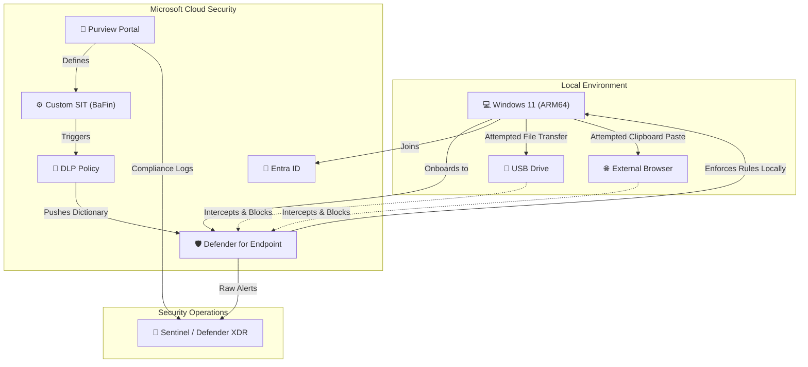

# 🏦 BaFin-Aligned Data Leakage Prevention (DLP): Multi-Vector Egress Monitoring & Rule Tuning

## 📌 Project Overview
This project demonstrates the design, deployment, and tuning of an enterprise Data Leakage Prevention (DLP) architecture using **Microsoft Purview** and **Microsoft Sentinel**. 

Designed to align with German banking regulations (BaFin/BAIT) and strict data secrecy (*Bankgeheimnis*), this lab models the detection, blocking, and SIEM investigation of sensitive financial data egress across three critical vectors:
1. **Email (Exchange Online)**
2. **Endpoint Removable Storage (USB)**
3. **Unsanctioned Web Uploads (Cloud/Browser)**

**Core Focus:** Transitioning from raw alerts to actionable intelligence by optimizing DLP rules to reduce false positives and documenting Tier-1 SOC investigations.

---

## 🏗️ Architecture Diagram

---

## 🏗️ Architecture & Lab Environment
* **Endpoint OS:** Windows 11 Enterprise (ARM64) virtualized via UTM/QEMU on macOS.
* **Identity:** Microsoft Entra ID (Azure AD) Joined.
* **Security Stack:** Microsoft Defender for Endpoint (Onboarded via Local Script), Microsoft Purview (Compliance Center).
* **Testing Payload:** Dummy documents containing custom BaFin markers (`SEC-DACH-FIN`) and DACH regional banking terms (`Kontoauszug`, `Depotbestand`, `Bankgeheimnis`).

---

## ⚙️ Phase 1: Custom Data Classification (BaFin Alignment)
To meet BaFin requirements, built-in metrics (like standard credit cards) are insufficient. I engineered a **Custom Sensitive Information Type (SIT)** tailored for proprietary German financial data.

* **Primary Element:** Keyword Dictionary (`DACH-Banking-Keywords`) containing terms like `Kontoeröffnung`, `Kunden-IBAN`, and a proprietary compliance marker: `SEC-DACH-FIN`.
* **Confidence Level:** Tuned exclusively for **High Confidence** to eliminate SOC alert fatigue and reduce false positives.
* **DLP Policy Rule:** Configured to strictly block the egress of this SIT to removable media and inter-app clipboard pasting.

---

## ☁️ Phase 2: Policy Logic Validation (Cloud-Side)
Before deploying to endpoints, DLP logic must be validated against the Purview classification engine to ensure the regex/dictionaries are compiling correctly. 

I generated a BaFin test document and ran it through the Purview SIT Cloud Tester. The engine successfully parsed the dictionary and triggered a **High Confidence** match across 8 unique proprietary keywords.

> **[🖼️ INSERT SCREENSHOT HERE: The Purview Cloud Test showing "High - 8 unique matches"]**

---

## 🛡️ Phase 3: Endpoint Enforcement & SOC Analyst Insights
Executing Endpoint DLP in a virtualized lab environment introduces enterprise-level hardware abstraction challenges that mirror complex VDI (Virtual Desktop Infrastructure) deployments. 

### 1. The USB Egress Block
The policy successfully synced to the local Windows Defender sensor, intercepting the transfer of BaFin-classified `.txt` and `.pdf` files to external drives.

> **[🖼️ INSERT SCREENSHOT HERE: The Windows toast notification showing the USB transfer being blocked]**

### 2. Environmental Constraints & Engineering Workarounds
As a DLP engineer, understanding infrastructure limitations is critical. During this deployment, two specific architectural constraints were identified and documented:

* **Hardware Virtualization Bypass (UTM/QEMU):** Virtual hypervisors frequently pass physical USB drives through to the guest OS as block devices (`QEMU HARDDRIVE`). Because Windows natively mounts these as non-removable internal disks, the Purview `Removable USB` trigger is initially bypassed. This required tuning the hypervisor's USB passthrough settings to ensure the OS recognized the removable bus.
* **Microsoft Custom Dictionary Propagation SLAs:** While built-in SITs (like SSNs or IBANs) trigger immediately upon policy creation, Microsoft Purview requires up to **24 hours** to compile Custom SIT dictionaries (like our BaFin keywords) and push them to local Defender endpoint sensors. This SLA must be factored into enterprise deployment timelines.

---

## 🔍 Phase 4: SIEM Integration & Threat Hunting
*(Add a brief sentence or two here if you have Sentinel screenshots showing the DLP alerts hitting your SIEM dashboard. If not, you can remove this section or state that alerts are successfully logging to the Microsoft 365 Defender unified portal for incident response).*

---

## 💡 Conclusion & Key Takeaways
This project validates that a successfully deployed Microsoft Purview architecture can enforce strict, regional compliance regulations (BaFin) at the hardware level. By mastering custom classification dictionaries, understanding endpoint sync propagation delays, and accounting for VDI hardware abstraction, an organization can effectively secure sensitive data without disrupting standard business operations.

