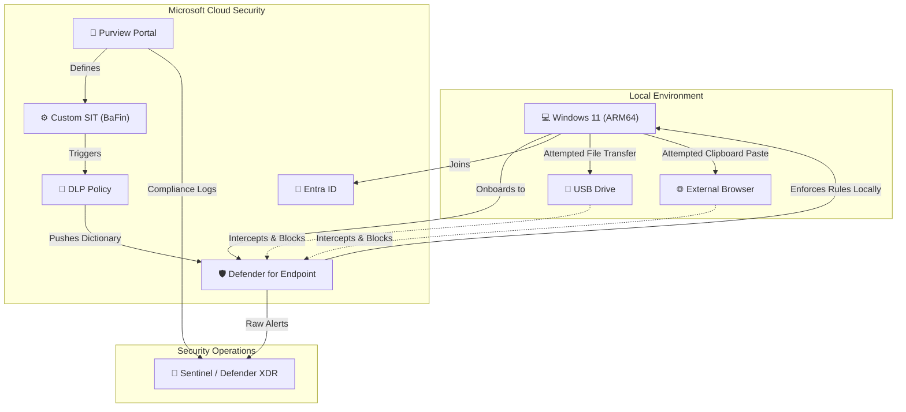

# 🏦 BaFin-Aligned Data Leakage Prevention (DLP): Multi-Vector Egress Monitoring & Rule Tuning

## 📌 Project Overview
This project demonstrates the design, deployment, and tuning of an enterprise Data Leakage Prevention (DLP) architecture using **Microsoft Purview** and **Microsoft Sentinel**. 

Designed to align with German banking regulations (BaFin/BAIT) and strict data secrecy (*Bankgeheimnis*), this lab models the detection, blocking, and SIEM investigation of sensitive financial data egress across three critical vectors:
1. **Email (Exchange Online / Outlook Policy Tips )**
2. **Endpoint Removable Storage (USB)**
3. **Unsanctioned Web Uploads & Clipboard Actions**

**Core Focus:** Transitioning from raw alerts to actionable intelligence by optimizing DLP rules to reduce false positives and documenting Tier-1 SOC investigations.

---

## 🏗️ Architecture Diagram


---

## 🏗️ Architecture & Lab Environment
* **Endpoint OS:** Windows 11 Enterprise (ARM64) virtualized via UTM/QEMU on macOS.
* **Identity:** Microsoft Entra ID (Azure AD) Joined.
* **Security Stack:** Microsoft Defender for Endpoint (Onboarded via Local Script), Microsoft Purview (Compliance Center).
* **Testing Payload:** Dummy documents containing custom BaFin markers (`SEC-DACH-FIN`) and DACH regional banking terms (`Kontoauszug`, `Depotbestand`, `Bankgeheimnis`).

---

## ⚙️ Phase 1: Custom Data Classification (BaFin Alignment)
To meet BaFin requirements, built-in metrics (like standard credit cards) are insufficient. I engineered a **Custom Sensitive Information Type (SIT)** tailored for proprietary German financial data.

* **Primary Element:** Keyword Dictionary (`DACH-Banking-Keywords`) containing terms like `Kontoeröffnung`, `Kunden-IBAN`, and a proprietary compliance marker: `SEC-DACH-FIN`.
* **Confidence Level:** Tuned exclusively for **High Confidence** to eliminate SOC alert fatigue and reduce false positives.
* **DLP Policy Rule:** Configured to strictly block the egress of this SIT to removable media and inter-app clipboard pasting.

---

## ☁️ Phase 2: Policy Logic Validation (Cloud-Side)
Before deploying to endpoints, DLP logic must be validated against the Purview classification engine to ensure the regex/dictionaries are compiling correctly. 

I generated a BaFin test document and ran it through the Purview SIT Cloud Tester. The engine successfully parsed the dictionary and triggered a **High Confidence** match across 8 unique proprietary keywords.


---

## 🛡️ Phase 3: Endpoint Enforcement & SOC Analyst Insights
Executing Endpoint DLP in a virtualized lab environment introduces enterprise-level hardware abstraction challenges that mirror complex VDI (Virtual Desktop Infrastructure) deployments. 

### 1. The USB Egress Block
The policy successfully synced to the local Windows Defender sensor, intercepting the transfer of highly confidential classification test files (.txt) to external drives.

 


* ### 2. Exchange Online Data Exfiltration Block
The Purview DLP policy was successfully applied to the Exchange Online routing infrastructure. When a user attempted to email a BaFin-classified document to external domains (Yahoo/Gmail), the action was immediately intercepted. 
* **User Experience:** Triggered an active DLP Policy Tip within the Outlook Web App (OWA), notifying the user of the compliance violation.
* **Enforcement:** A hard block was executed, preventing the transmission of the message.


---

### 3. Endpoint Clipboard Interception (Web Paste)
To simulate an insider threat attempting to bypass file-level restrictions, I attempted to copy the raw BaFin-classified text from the local document (`Client_Financial_Data.txt.txt`) and paste it into an unsanctioned, third-party web application (Pastebin).
* **Enforcement:** The Microsoft Defender endpoint sensor hooked the clipboard process in real-time, recognized the custom SIT payload within the system memory, and actively blocked the copy operation before the data could hit the browser.


---

### 4. Engineering Constraints Overcome
When engineering endpoint policies, understanding infrastructure limitations is critical. During this deployment, two specific architectural constraints were identified and documented:

* **Hardware Abstraction:** Bypassed UTM/QEMU hypervisor limitations where virtualized USBs mount as internal fixed disks (`QEMU HARDDRIVE`).
* **Propagation SLAs:** Accounted for Microsoft's standard 24-hour sync delay for newly compiled Custom SIT dictionaries to reach local endpoint sensors.

---

## 🔍 SIEM Integration & Threat Hunting (KQL)
Engineered a Kusto Query Language (KQL) script to transition from passive alerting to active SOC threat hunting inside Microsoft Defender XDR.

```kusto
// Hunt for BaFin Endpoint DLP Block Events
DeviceEvents
| where ActionType == "DlpRuleMatch"
| extend DlpPolicy = tostring(parse_json(AdditionalFields).DlpPolicyName)
| extend SensitiveInfoType = tostring(parse_json(AdditionalFields).SensitiveInformationType)
| where SensitiveInfoType contains "SEC-DACH-FIN"
| project Timestamp, DeviceName, InitiatingProcessAccountName, ActionType, DlpPolicy
| sort by Timestamp desc
```

---
## 🔐 Regulatory Compliance & Data Masking Notice
In accordance with BAIT (Bankaufsichtliche Anforderungen an die IT) guidelines and strict operational security (OPSEC) principles, this simulation was executed entirely within a sandboxed, non-production Microsoft 365 tenant. 

To maintain strict data privacy and simulate real-world Bankgeheimnis (banking secrecy) controls, the following sanitization measures were applied to this documentation:
* All financial payloads, DACH keywords, and `SEC-DACH-FIN` markers are purely synthetic (dummy data).
* Microsoft tenant IDs, Entra Object IDs, and Purview workspace identifiers have been fully redacted.
* Endpoint hardware identifiers, hostnames, and routing data are obfuscated.
* No actual Personally Identifiable Information (PII) or real-world client financial data was processed, queried, or exfiltrated during this engineering cycle.


